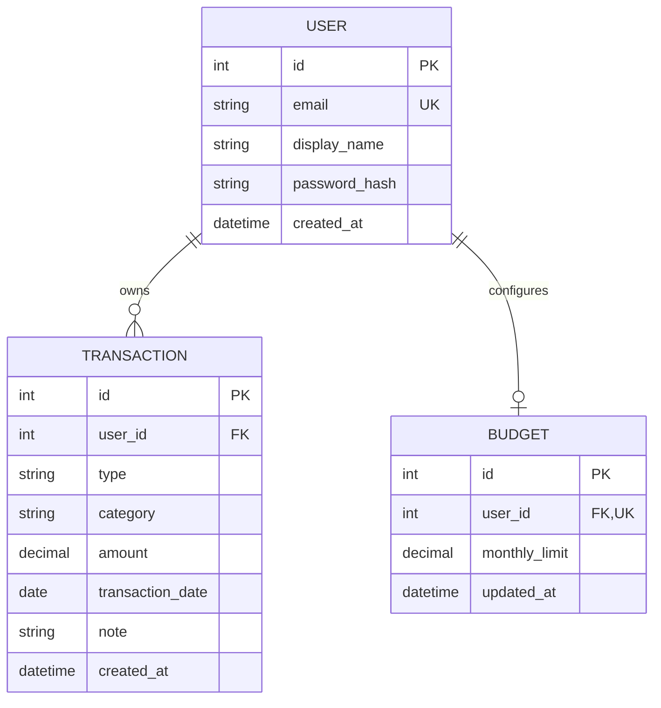

# Money Tracker

**Author:** Arstanalieva Bermet  
**Date:** October 6, 2026

An account-based personal finance tracker for recording income and expenses, reviewing monthly spending, and setting a budget. The interface is in Russian and uses tenge (₸), following the supplied single-file prototype. This project is developed as a university Computer Science project.

## Features

- Registration, login, JWT authentication, and per-user data isolation
- Expense and income transaction CRUD with server- and client-side validation
- Month navigation, daily grouping, search, and monthly summary
- Expense/income category charts, daily chart, and spending insight
- Monthly budget tracking
- Profile settings, CSV export, demo data, delete-all-data, and theme selection
- Responsive desktop sidebar and mobile bottom navigation

## Screenshots

| Light theme | Dark theme | Phone layout |
| --- | --- | --- |
| `docs/screenshots/light.png` (placeholder) | `docs/screenshots/dark.png` (placeholder) | `docs/screenshots/mobile.png` (placeholder) |

## Tech Stack

- Python 3.11+, FastAPI, Pydantic v2, SQLAlchemy 2.x, Alembic
- SQLite by default; PostgreSQL supported through `DATABASE_URL`
- Vanilla HTML, CSS, and JavaScript ES modules
- pytest, HTTPX, Ruff, Docker Compose, and GitHub Actions

## Data Model



## API

All endpoints are under `/api`. Interactive OpenAPI documentation is available at `/docs`.

| Method | Endpoint | Purpose |
| --- | --- | --- |
| POST | `/api/auth/register` | Create an account |
| POST | `/api/auth/login` | Authenticate and receive an access token |
| GET | `/api/auth/me` | Get the authenticated profile |
| GET, POST | `/api/transactions` | List or create transactions (`month`, `type`, `q` filters) |
| PUT, DELETE | `/api/transactions/{id}` | Update or delete an owned transaction |
| GET | `/api/stats/summary?month=YYYY-MM` | Monthly income, expense, and balance totals |
| GET | `/api/stats/by-category?month=YYYY-MM&type=expense` | Category totals and percentages |
| GET | `/api/stats/by-day?month=YYYY-MM` | Daily totals for the selected month |
| GET, PUT | `/api/budget` | Read or update the monthly budget |
| GET | `/api/export/csv` | Export the authenticated user's transactions |
| POST | `/api/demo-data` | Add sample transactions to the current account |
| DELETE | `/api/data` | Delete the current user's transactions and budget |

## Local Setup

Requires Python 3.11 or newer.

```powershell
cd backend
python -m venv .venv
.\.venv\Scripts\Activate.ps1
pip install -r requirements.txt
Copy-Item ..\.env.example ..\.env
alembic upgrade head
uvicorn app.main:app --reload
```

Open [http://localhost:8000](http://localhost:8000). Configure `DATABASE_URL` and set a unique `JWT_SECRET_KEY` in `.env` before deployment. The default local database is SQLite.

## Docker

```powershell
docker compose up --build
```

The app is available at [http://localhost:8000](http://localhost:8000); API documentation is at `/docs`.

## Tests and Lint

```powershell
cd backend
pytest
ruff check .
```

The CI workflow runs both checks on every push and pull request.

## Known Issues

- Google Fonts require an internet connection; system serif and sans-serif fallbacks are provided.
- SQLite is intended for local development; use PostgreSQL for multi-instance deployments.

## Roadmap

- Add recurring transactions and reminders
- Add configurable category management
- Add downloadable monthly reports
- Add optional multi-currency support