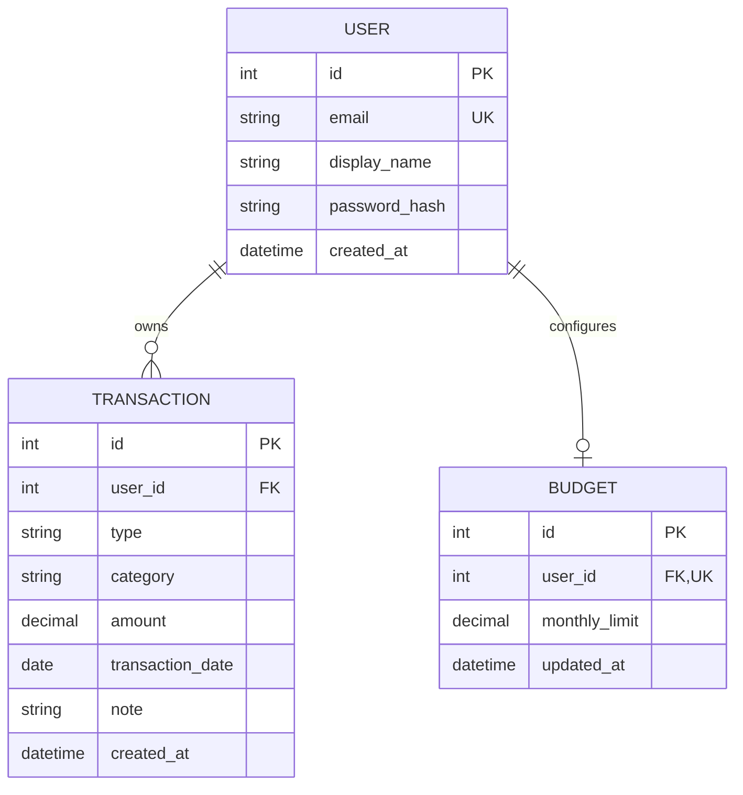

# Money Tracker

**Author:** Arstanalieva Bermet

**Original proposal:** September 22, 2026

**Current version:** October 6, 2026

Money Tracker is a personal finance application for recording income and expenses, reviewing monthly spending, and setting a budget. It is developed as a university Computer Science project. The interface is in Russian and uses tenge (₸), following the supplied visual prototype.

## Project Evolution

The Version 1 proposal, written September 22, 2026, described a local, single-user expense tracker built with Python, Streamlit, and SQLite. Its core goals were to add an expense, view and delete entries, and chart spending by category.

The implemented version keeps the original goals and local SQLite option, and expands the project into a full-stack application. The UI is built with vanilla HTML, CSS, and JavaScript modules and served by FastAPI. It now supports income as well as expenses, user accounts, per-user data isolation, editing, monthly summaries, search, budgets, richer statistics, CSV export, and responsive light/dark themes. PostgreSQL can be selected with `DATABASE_URL`.

This is an implementation change from the original proposal: the current application does not use Streamlit and is not a no-account application. The original proposal remains useful as the project baseline; the scope and revised schedule below describe the implemented version.

## Features

- Registration, login, JWT authentication, and per-user data isolation
- Expense and income transaction CRUD with server- and client-side validation
- Month navigation, daily grouping, search, and monthly summary
- Expense/income category charts, daily chart, and spending insight
- Monthly budget tracking
- Profile settings, CSV export, demo data, delete-all-data, and theme selection
- Responsive desktop sidebar and mobile bottom navigation

## Screenshots

| Light theme | Dark theme | Phone layout |
| --- | --- | --- |
| `docs/screenshots/light.png` (to add) | `docs/screenshots/dark.png` (to add) | `docs/screenshots/mobile.png` (to add) |

## Revised Development Plan

The plan below maps the original 13-week milestones to the expanded implementation. “Complete” means implemented and checked locally; hosted deployment and screenshot capture remain pending.

| Week | Development milestone | Deliverable / status |
| --- | --- | --- |
| 1 | Define the project and create the repository | Version 1 proposal and README; complete |
| 2 | Design the data model and project structure | SQLAlchemy user, transaction, and budget schema with Alembic migration; complete |
| 3 | Create the web application foundation | FastAPI app serving the modular frontend; complete |
| 4 | Persist application data | SQLite configuration, PostgreSQL URL support, and migration path; complete |
| 5 | Implement account registration and login | Password hashing, JWT auth, profile API, and tests; complete |
| 6 | Build expense and income entry and list | Validated transaction CRUD, month grouping, and search; complete |
| 7 | Add monthly spending summaries and charts | Statistics and daily chart endpoints/views; complete |
| 8 | Add budget and settings workflows | Budget, profile, theme, CSV, demo data, and delete-data features; complete |
| 9 | Add verification and automated checks | 34 API tests, Ruff, and GitHub Actions workflow; complete locally |
| 10 | Test edge cases and responsive behavior | Validation, account isolation, and 375px browser check; complete locally |
| 11 | Package for deployment | Dockerfile and Compose configuration; added, Docker image runtime not verified locally |
| 12 | Capture final presentation screenshots | Light, dark, and phone screenshots in `docs/screenshots/`; pending |
| 13 | Prepare final demo and submission | 3–5 minute demo, repository link, and hosted URL; pending |

The Version 1 plan proposed Streamlit Community Cloud deployment. Because the implementation changed to FastAPI with a separate vanilla-JavaScript frontend, deployment should use a host that can run the Docker image (or the Python app directly) rather than Streamlit Community Cloud.

## Tech Stack

- Python 3.11+, FastAPI, Pydantic v2, SQLAlchemy 2.x, Alembic
- SQLite by default; PostgreSQL supported through `DATABASE_URL`
- Vanilla HTML, CSS, and JavaScript ES modules
- pytest, HTTPX, Ruff, Docker Compose, and GitHub Actions

## Data Model



## API

All endpoints are under `/api`. Interactive OpenAPI documentation is available at `/docs`.

| Method | Endpoint | Purpose |
| --- | --- | --- |
| POST | `/api/auth/register` | Create an account |
| POST | `/api/auth/login` | Authenticate and receive an access token |
| GET | `/api/auth/me` | Get the authenticated profile |
| GET, POST | `/api/transactions` | List or create transactions (`month`, `type`, `q` filters) |
| PUT, DELETE | `/api/transactions/{id}` | Update or delete an owned transaction |
| GET | `/api/stats/summary?month=YYYY-MM` | Monthly income, expense, and balance totals |
| GET | `/api/stats/by-category?month=YYYY-MM&type=expense` | Category totals and percentages |
| GET | `/api/stats/by-day?month=YYYY-MM` | Daily totals for the selected month |
| GET, PUT | `/api/budget` | Read or update the monthly budget |
| GET | `/api/export/csv` | Export the authenticated user's transactions |
| POST | `/api/demo-data` | Add sample transactions to the current account |
| DELETE | `/api/data` | Delete the current user's transactions and budget |

## Local Setup

Requires Python 3.11 or newer.

```powershell
cd backend
python -m venv .venv
.\.venv\Scripts\Activate.ps1
pip install -r requirements.txt
Copy-Item ..\.env.example ..\.env
alembic upgrade head
uvicorn app.main:app --reload
```

Open [http://localhost:8000](http://localhost:8000). Configure `DATABASE_URL` and set a unique `JWT_SECRET_KEY` in `.env` before deployment. The default local database is SQLite.

## Docker

```powershell
docker compose up --build
```

The app is available at [http://localhost:8000](http://localhost:8000); API documentation is at `/docs`. Compose persists SQLite data in a named volume. To configure JWT signing or use PostgreSQL, set `JWT_SECRET_KEY` and `DATABASE_URL` in an untracked root `.env` file. The app generates an ephemeral signing key when none is provided, which is suitable only for local development.

## Tests and Lint

```powershell
cd backend
pytest
ruff check .
```

The CI workflow runs both checks on every push and pull request.

## Known Issues

- Google Fonts require an internet connection; system serif and sans-serif fallbacks are provided.
- SQLite is intended for local development; use PostgreSQL for multi-instance deployments.
- Docker Compose configuration is present, but the image has not yet been built in an environment with Docker Desktop running.
- Final light, dark, and mobile screenshots and a hosted deployment URL have not yet been added.

## Roadmap

- Add recurring transactions and reminders
- Add configurable category management
- Add downloadable monthly reports
- Add optional multi-currency support